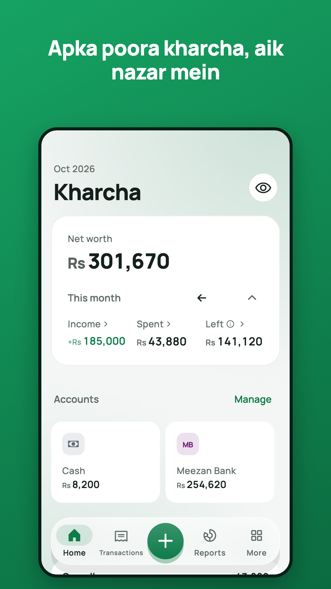
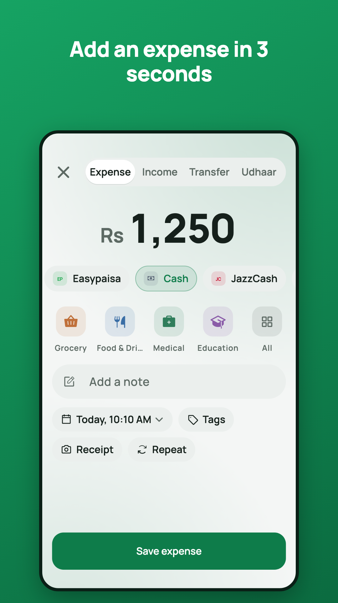
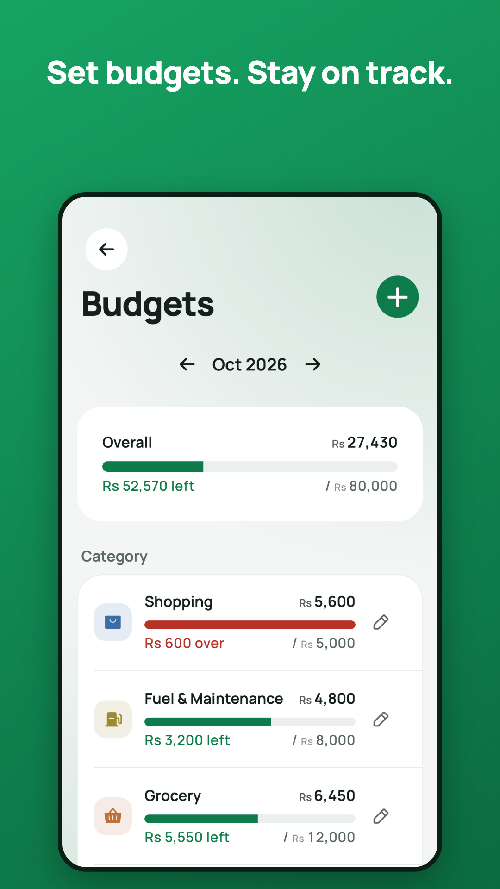
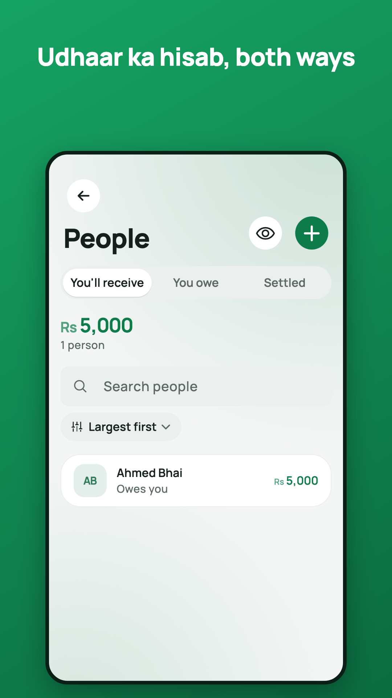
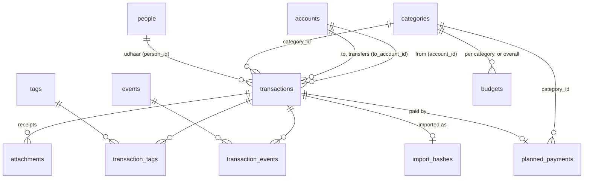

# Kharcha

**Roz ka hisab, asaan.** A budget and expense tracker that keeps your money
records on your phone. It works offline, needs no account, shows no ads and
is free.

Built with Flutter for Android and iOS. Package / bundle id:
`com.expensetracker.kharcha`.

- Home page: <https://ismail-ilm66.github.io/khaata_digital/>
- [Privacy policy](docs/privacy-policy.md) · [Terms of use](docs/terms.md)

<p>
  
  
  
  
</p>

## What it does

- **Entries in a few taps:** expenses, income, transfers between accounts,
  and udhaar (money lent or borrowed) with people. Notes, tags and receipt
  photos are optional.
- **Split a bill** with people: your share is recorded as the expense and
  each person's share as udhaar, with every amount editable.
- **Accounts:** cash, banks and wallets, with ready-made banks for 16
  countries, net worth and the option to hide balances.
- **Budgets on your pay cycle:** a month that starts on any day, or on the
  last working day, overall or per category.
- **To pay:** a list of what you still have to pay (charity, a bill, a
  promise), recorded as an expense in one tap when paid.
- **Recurring bills** with reminders.
- **Reports** for any period, with Excel and CSV export.
- **Import** from Hysab Kytab's Excel export (balances reproduced to the
  paisa) or any CSV.
- **Backups** to a file or to the user's own Google Drive (weekly if wanted,
  optionally encrypted with a passphrase), restorable on any phone.
- **App lock** with a PIN, fingerprint or Face ID.
- **English and Urdu** (right-to-left), light and dark mode, a how-to tour for
  first-time users.

## Privacy by design

All data stays in the app's private storage on the phone. There is no
server, no analytics, no crash reporting and no ads. The only network use is
Google Drive backup, when the user turns it on; it can see only the files
Kharcha creates (`drive.file` scope). The full policy is in
[docs/privacy-policy.md](docs/privacy-policy.md), which is also bundled into
the app.

## Getting started

Requirements: Flutter 3.38 (Dart 3.10) and the Android SDK, plus Xcode for
iOS (deployment target 14.0).

```bash
git clone git@github.com:ismail-ilm66/khaata_digital.git
cd khaata_digital
cp .env.example .env        # fill in, see below; required to build
flutter pub get
flutter run
```

### `.env`

App settings are read at runtime with `flutter_dotenv`. The file is bundled
inside the app, so it must never hold secrets. Leave a value empty to turn its
feature off.

| Key | What it is |
|---|---|
| `GOOGLE_SERVER_CLIENT_ID` | Google Cloud OAuth client of type **Web application**, used for Drive sign-in on Android. |
| `GOOGLE_IOS_CLIENT_ID` | OAuth client of type **iOS** for the same bundle id. |
| `SUPPORT_EMAIL` | Where More → About → Contact us sends email. |

For Drive sign-in, Google Cloud also needs an **Android** OAuth client for
each signing key's SHA-1 (debug, upload and Play app signing). The steps are
in [docs/release-readiness.md](docs/release-readiness.md).

### Release signing

Copy `android/key.properties.example` to `android/key.properties`, and put the
upload keystore at `android/app/kharcha-upload.jks`. Both are git-ignored and
must stay that way.

## Project layout

```
lib/
  core/        shared building blocks: database (Drift), money, dates,
               routing, theme, widgets, localisation
  features/    one folder per feature, each split into
               domain/ (entities, repository interfaces),
               data/ (DAOs, repository implementations),
               presentation/ (screens, BLoCs and cubits)
test/          unit, widget and golden tests
integration_test/  key flows, backup/restore and reminders on a device
docs/          GitHub Pages site (home page, privacy, terms), launch checklist
store/         Play listing text, screenshots, feature graphic
tool/          release gate, coverage gate, store and brand renderers
drift_schemas/ snapshots of every database schema version
```

Architecture: clean architecture with `flutter_bloc`, `get_it` + `injectable`
for dependencies, `go_router` for navigation and Drift (SQLite) for storage.
Every non-obvious choice is recorded in [DECISIONS.md](DECISIONS.md).

House rules the code follows:

- Money is never a `double`; amounts are integer minor units (`Money`).
- Date maths lives only in `lib/core/dates/`.
- Every feature ships with tests.
- No network except Google Drive backup.

## Common commands

```bash
# Code generation (Drift, injectable)
dart run build_runner build --force-jit --delete-conflicting-outputs

# Translations (lib/core/l10n/arb → generated code)
flutter gen-l10n

# Tests
flutter test
flutter test integration_test/key_flows_test.dart -d <device>

# Store screenshots and feature graphic (also refreshes docs/assets/screens)
flutter test tool/store/render_store_test.dart

# Everything that must pass before a store upload
tool/release_check.sh
```

`tool/release_check.sh` is the release gate (there is no CI by choice). It
checks formatting and analysis, runs every test, re-runs the golden backups
explicitly, requires ≥ 80 % coverage of core and domain code, and builds and
verifies the signed release bundle.

## How the data is managed

Everything lives in one SQLite database on the phone (`kharcha.sqlite` in
the app's documents folder), accessed through
[Drift](https://drift.simonbinder.eu/). The schema is in
[`lib/core/db/tables.dart`](lib/core/db/tables.dart); the current version is
**3**.

### Rules every table follows

- **Ids are UUIDs** (text), so rows from two phones can be merged on restore
  without clashing.
- **Times are UTC epoch milliseconds**, shown in local time. Calendar dates,
  such as a due date, are stored as UTC midnight of that date, so they never
  shift with time zones.
- **Money is an integer in minor units** (paisa, cents) with a three-letter
  currency code beside it. There are no floating-point amounts anywhere.
- **Nothing is hard-deleted.** Rows get a `deleted_at` time and are hidden,
  so history survives and restores can merge cleanly. Archiving an account or
  category frees its name for reuse.
- **Names are unique among live rows, case-insensitively** (partial unique
  indexes), for accounts, categories (per income/expense), people and tags.
- **Balances are never stored.** An account's balance is its opening balance
  plus the effect of its live entries, worked out in SQL
  ([`ledger_sql.dart`](lib/core/db/ledger_sql.dart)). The same goes for
  udhaar balances and budget spending, so they can't drift out of step.
- SQLite runs with foreign keys on and in WAL mode, and an integrity check
  runs at every start; on failure, Home offers a restore.

### Tables



| Table | Holds |
|---|---|
| `accounts` | Cash, bank, wallet, card and savings accounts: currency, opening balance, icon and colour, sort order, "leave out of net worth". |
| `transactions` | Every entry. `type` is expense, income, transfer or adjustment. A transfer is **one** row with `to_account_id` (and, across currencies, the amount received and the rate used). An entry with `person_id` is udhaar: an expense means you gave, an income means you received. Check constraints keep amounts positive and transfers well-formed. |
| `categories` | Income and expense categories (the Hysab Kytab set, plus Investment for expenses), ordered by the user. |
| `people` | People for udhaar. Their balances come from linked transactions. |
| `tags`, `transaction_tags` | Free labels on entries (many-to-many). |
| `events`, `transaction_events` | Event labels carried over from Hysab Kytab imports. |
| `attachments` | Receipt metadata (file name, size, SHA-256). The images themselves are JPEG files in the app's `receipts/` folder. |
| `budgets` | A limit per budget cycle (year + month of its start), either overall (`category_id` null) or for one category. |
| `recurring_rules` | Repeating entries: a JSON template of the entry, the frequency and the next run time; due entries are created on start and in the background. |
| `planned_payments` | The To-pay list: what for, amount, optional category and due date, and when it was paid and by which entry. |
| `settings` | Key-value preferences (currency, month start, theme, language, app lock and so on). Phone-specific keys, such as the PIN and the Google account, are never restored onto another phone. |
| `import_hashes` | A hash of every imported source row, so importing the same file twice adds nothing. |
| `backup_meta` | This phone's backup history (when, where, row counts). |

### Backups and restore

A backup is a `.kharcha` file: a ZIP holding `manifest.json` (app and schema
version, row counts, checksums), `data.db` (a consistent copy of the
database) and the receipt images. With a passphrase, the database and
receipts are sealed together with AES-256-GCM, using a key derived with
PBKDF2.

Restoring opens the backup with the current app, so an older backup is
migrated first, then either **replaces** everything or **merges**. Merging
keeps this phone's data and adds the backup's: same-name accounts,
categories, people and tags are treated as one, and where an entry exists in
both, the more recent edit wins. An automatic backup is saved before every
restore and import.

### Schema versions

| Version | Change |
|---|---|
| 1 | First release. |
| 2 | `import_hashes`, so imports can be run again safely. |
| 3 | `planned_payments`, the To-pay list. |

Each version's schema is snapshotted in [`drift_schemas/`](drift_schemas/),
and migrations run step by step (v1 → v2 → v3) when the app opens an older
database.

## Changing the database

Every schema version ever shipped has a **golden database** in
`test/fixtures/golden/vN/`, with balances worked out by hand. Each one must
open in the current app and reproduce those numbers to the paisa. To change
the schema:

1. Edit `lib/core/db/tables.dart` and bump `schemaVersion`.
2. Run `dart run drift_dev make-migrations`.
3. Write the step in `AppDatabase.migration`.
4. Generate the new fixture and hand-write its `expected.json`; never touch an
   older one.

The details are in [test/golden/README.md](test/golden/README.md).

## Docs

- [DECISIONS.md](DECISIONS.md): what was decided and why, numbered.
- [docs/release-readiness.md](docs/release-readiness.md): the launch
  checklist, Play data-safety answers and deferred work.
- [store/](store/): the Play listing in English and Urdu.
